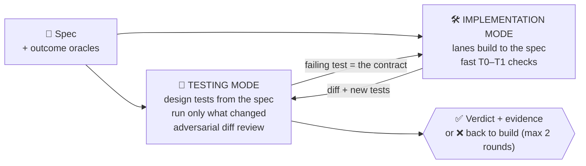
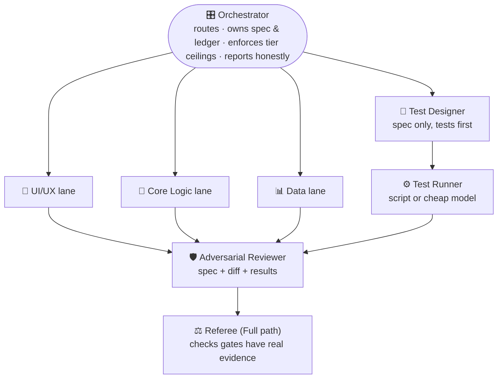
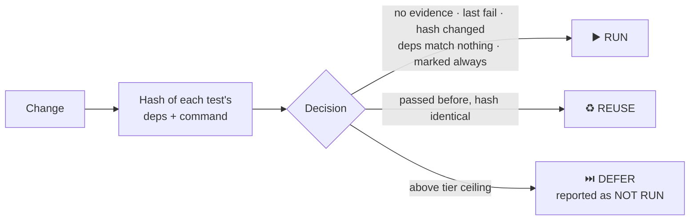

<div align="center">

# 🦅 MACA — Multi-Agent Collaborative Audit

### One agent grades its own homework. MACA makes a team do it properly, and cheaply.

**Build and verify with separate agents · reuse proven test results · pay for tokens once**

[](LICENSE)


[Why](#-why-maca) · [Two modes](#-two-complementary-modes) · [Team](#-the-team) · [Savings](#-spend-effort-only-where-it-matters) · [Packs](#-domain-packs-directions-not-data) · [Results](#-measured-results) · [Quickstart](#-quickstart) · [Reference](#-reference)

</div>

---

## 💡 Why MACA

An agent that reviews its own work shares its own blind spots: the tests it wrote pass, the spec it assumed looks right, and the real app still breaks. Deep test suites fix that, until re-running them on every change burns your tokens and your afternoon.

MACA fixes both problems with structure, not ceremony:

| Problem | MACA's answer |
|---|---|
| Self-review misses what the author missed | **Separate who builds from who checks.** Tests come from the spec, before the code. Reviewers never see the author's reasoning |
| Green tests, broken app | **Outcome oracles** asserted at domain, storage and UI level, through the real code path |
| Re-running everything every time | **Evidence cache**: a passed test is reused until something it depends on changes |
| Rewriting the same helper script | **Harness library**: the second time a script is needed, it is saved and reused by name |
| Paying full price for repeated context | **Cache-friendly briefs**: stable prefix first, sessions kept alive, cheap models for cheap jobs |
| One skill locked to one industry | **Neutral core + packs.** An intake step learns the project once |

---

## 🔀 Two complementary modes



Each mode runs alone or together. The spec's *oracles* are the contract: testing turns them into tests, implementation makes them pass, and a defect found in review becomes a failing test.

---

## 👥 The team



**Independence rule:** Test Designer ≠ Builder, Reviewer ≠ Author. When separation is impossible, MACA launches a fresh process and labels it *same-model review* instead of pretending.

**Proportional by design:** a small change gets the **Light** path (a reviewer that did not write the code, tests you actually ran, one short report). High-stakes or multi-lane work gets the **Full** path (phases 0–5).

---

## 💸 Spend effort only where it matters

### Test tiers and the evidence cache

| Tier | What | Default |
|---|---|---|
| T0 | lint / typecheck | every change |
| T1 | unit tests on touched code | every change |
| T2 | integration / flow tests | each Full-path round |
| T3 | full regression | at close, release gate |
| T4 | deep profiling | only on request |



```bash
python3 scripts/impact_and_cache.py select --ws . --max-tier 2   # prints RUN / REUSE / DEFER
python3 scripts/impact_and_cache.py record --ws . --id <test> --status pass
```

Deferred tests are never reported as passed. Failed tests and unmatched dependencies always run.

### Harness library (rule of two)

```text
need a helper script?  →  harness.py check
    FOUND   → run it by name
    PROMOTE → second time you need it: write once, register with a self-test, reuse forever
    NEW     → write inline (register on first use if the task will recur)
```

Scopes: per project (`.agents/harness/`) and a shared global library. Hashes are verified on every run.

### Prompt-cache-friendly briefs

Every role brief = one shared stable prefix (profile, spec summary, oracles) + a short role-specific tail. Stable material first, changing material last, sessions continued instead of re-uploaded, strong model for spec and review, cheap model or a script for runs. Savings come from the provider's prompt caching (cached reads are billed at a small fraction of normal input price; check your provider's current rates) and from not repeating work. See `references/token_economy.md`.

---

## 🧭 Intake: learn the direction once

The first time MACA runs in a project it asks a short set of questions: purpose, audience, what a serious failure looks like, areas touched, build and test commands, cost preference, approvers, model tiers. The answers become `.agents/PROJECT_PROFILE.md`, which selects the packs, the default weight, the tier ceilings and the model tiers. It is asked **once** and reused. Unattended runs infer from the repo, mark every guess `(inferred - confirm)`, and choose the cautious option.

---

## 📦 Domain packs: directions, not data

Packs add checks; they never contain domain values. Thresholds, doses, rates, enums and scenarios come from **your project's files** with a named source and approver. A value without one is reported as *unverified*.

| Pack | For |
|---|---|
| `core` | every project |
| `fintech` | money, ledgers, payments |
| `systems` | runtimes, concurrency, performance |
| `data-etl` | pipelines, migrations, reports |
| `clinical` | health and other safety-critical software (directions only) |

---

## 📊 Measured results

Four evaluation rounds compared this version with the previous skill on realistic tasks, graded against written assertions (single run per case, so treat as indicative).

| Round | Focus | New | Old |
|---|---|---|---|
| 1 | review quality, linter, auth matrix | 93% | 80% |
| 2 | after fixes, tighter Light path | 100% | 80% |
| 3 | cache reuse, selective retest | 97% | 79% |
| 4 | neutral packs, intake, harness | 87% | 43%* |

\* Round 4 mostly tests features the old version lacks, so that gap is expected and not a like-for-like comparison. Real token-cost savings depend on your provider's caching and were not measured here.

---

## 🚀 Quickstart

```bash
# 1. Check the environment and skill integrity
bash scripts/bootstrap.sh

# 2. Ask your agent: "Use MACA to build/verify <feature>"
#    First run triggers intake and writes .agents/PROJECT_PROFILE.md

# 3. Verify only what changed
python3 scripts/impact_and_cache.py select --ws . --max-tier 2
```

Zero-API mode works with in-IDE subagents. With installed CLIs (`claude`, `codex`, `opencode`, `gemini`, `agy`) the router dispatches lanes across different models for more independent review (`python3 scripts/fleet_dispatch.py --detect-only`).

## 🛠️ Scripts

| Script | Purpose |
|---|---|
| `impact_and_cache.py` | select RUN / REUSE / DEFER, record evidence, invalidate |
| `harness.py` | check / register / run / promote reusable helper scripts |
| `fleet_dispatch.py` | model-agnostic multi-CLI router with fallback |
| `scenario_and_callchain_engine.py` | sequential scenarios, caller tracing, auth-fuzz matrix |
| `skill_ambassador_auditor.py` | procedural gates and compliance log |
| `lint_samd_invariants.py`, `lint_design_and_ux.py` | safety/auth and UI linters (0 files scanned ≠ evidence) |
| `first_run_preflight.py`, `bootstrap.sh` | integrity checks and environment discovery |
| `measure_metrics.py` | telemetry dashboard and notifications |

All scripts use only the Python standard library, support `--self-test`, and **fail closed**.

## 📚 Reference

* `SKILL.md`: the skill itself
* `references/`: roles and modes, test economy, token economy, intake, verification principles
* `docs/FLEET_AND_V2_REFERENCE.md`: the earlier detailed guide to the fleet router, adapters, Ponytail ladder and dashboard

---

<div align="center">

Licensed under the [MIT License](LICENSE).

</div>
