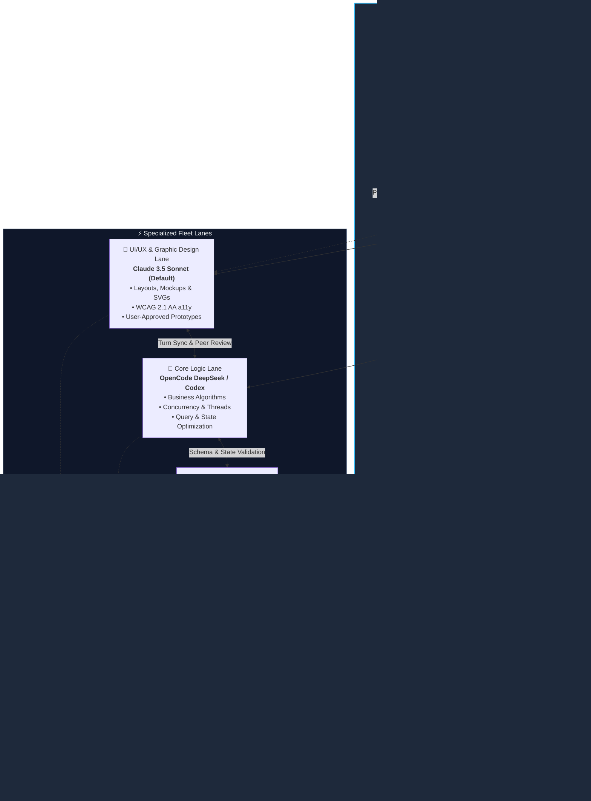
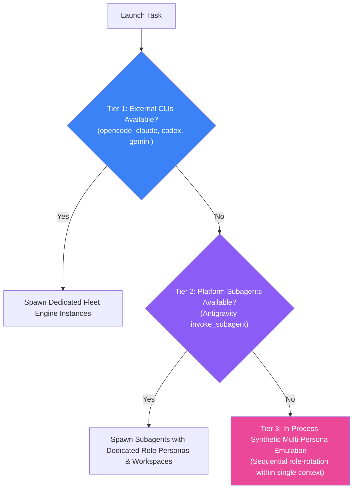

# 🦅 Multi-Agent Collaborative Audit (MACA)

> **Spec-Driven, Ponytail-Optimized, and Fleet-Delegated Multi-Agent Engineering & Audit Skill for AI Orchestrators.**

[](LICENSE)
[](https://deepmind.google)
[](#the-5-phase-sdd-workflow)
[](#-the-ponytail-minimalism-engine)
[](#-affiliations--philosophical-lineage)

---

## 🎯 Overview & Mission

Modern AI-assisted engineering often suffers from **three fatal failure modes**:
1. **Agent Bloat & Overengineering**: LLMs write speculative abstractions, introduce unnecessary third-party packages, or compress logic into unreadable "clever" one-liners.
2. **Infinite Review Loops**: Multi-agent critique loops spin out of control with circular disagreements and mutual finger-pointing.
3. **Environment Fragility & Delusion**: Agents assume external proprietary CLIs are always available, hallucinating tools or crashing when sandboxed.

**Multi-Agent Collaborative Audit (MACA)** is a production-grade orchestration skill led by **Antigravity** as the Principal Consultant. It partitions software engineering and auditing into distinct, specialized **Fleet Lanes**, drives execution through a **7-Rung Minimalism Ladder (Ponytail Engine)**, bounds peer critiques to **2 rounds maximum**, and provides a **3-Tier Scarcity Cascade** ensuring continuous execution in any development environment.

---

## 🏛️ Fleet Architecture & Lane Routing



---

## 🪢 The Ponytail Minimalism Engine

The **Ponytail Minimalism Engine** enforces a strict, hierarchical decision ladder. When implementing or reviewing code, every agent must evaluate options from **Rung 1** upward, ascending only when mathematically or functionally necessary:

```mermaid
flowchart LR
    R1["<b>Rung 1</b><br/>YAGNI<br/><i>Cut speculative code</i>"] -->
    R2["<b>Rung 2</b><br/>Existing Helper<br/><i>Reuse repo utils</i>"] -->
    R3["<b>Rung 3</b><br/>Standard Library<br/><i>Language primitives</i>"] -->
    R4["<b>Rung 4</b><br/>Platform / OS API<br/><i>Native web/mobile APIs</i>"] -->
    R5["<b>Rung 5</b><br/>Installed Dep<br/><i>Existing package.json</i>"] -->
    R6["<b>Rung 6</b><br/>Atomic Primitive<br/><i>Clean readable function</i>"] -->
    R7["<b>Rung 7</b><br/>Custom High-Perf<br/><i>Bespoke optimization</i>"]

    style R1 fill:#22c55e,color:#000
    style R2 fill:#4ade80,color:#000
    style R3 fill:#a3e635,color:#000
    style R4 fill:#facc15,color:#000
    style R5 fill:#fb923c,color:#000
    style R6 fill:#f87171,color:#000
    style R7 fill:#ef4444,color:#fff
```



### 🛑 Inviolable Guardrails: Minimalism $\neq$ Sloppiness
Under no circumstances may an agent skip or weaken:
1. **Input validation & schema integrity** (nullability, bounds, type safety).
2. **Defensive error handling** (no swallowed exceptions or silent failures).
3. **Security barriers** (CSRF, sanitization, least-privilege auth).
4. **Accessibility (a11y)** (screen readers, semantics, contrast).
5. **Domain/Clinical precision** (dosages, financial decimals, unit conversions).

---

## 🔄 The 5-Phase SDD Workflow

```mermaid
sequenceDiagram
    autonumber
    actor Dev as Developer / User
    participant Orch as 🦅 Antigravity Orchestrator
    participant UILane as 🎨 UI/UX Lane (Claude Default)
    participant Lanes as 👥 Fleet Lanes (Logic / Data)
    participant QA as 🛡️ QA & Audit Lane
    participant Ledger as 📜 Governance Ledger (.agents/)

    Dev->>Orch: Submit Feature / Audit Request
    Note over Orch: Phase 0: Non-blocking bootstrap (bootstrap.sh)
    Orch->>Ledger: Generate AGENTS.md & AI_HANDOFF_LEDGER.md
    Note over Orch: Phase 1: Zero-Presumption Audit
    Orch->>Ledger: Formulate SPEC_AND_AUDIT.md

    rect rgb(45, 30, 60)
        Note over Orch,UILane: Phase 1.5: UI/UX & Graphic Mocking (Visual Gate)
        Orch->>UILane: Request Standalone Mockup (HTML/CSS/SVG)
        UILane->>Dev: Present Interactive Mockup & File Path
        Dev-->>Orch: Review & Sign-Off (APPROVED)
    end

    Note over Orch: Phase 2: Partition Tasks (Mock Bound to Plan)
    Orch->>Ledger: Populate PLAN_TASKS.md (Ref: Approved Mock)

    rect rgb(30, 41, 59)
        Note over Lanes,QA: Phase 3: Delegated Execution & Peer Review
        Orch->>Lanes: Assign Tasks (Ponytail Ladder Enforced)
        Lanes->>Lanes: Internal Lane Implementation
        Lanes->>QA: Submit PR Diff for Peer Review
        QA-->>Lanes: Critique (Max 2 Rounds)
        alt Hard Blocker Found
            Lanes->>Lanes: Implement Immediate Patch
        else Deferred Shortcut
            Lanes->>Ledger: Tag // ponytail: and record in Debt Ledger
        else Cross-Lane Deadlock
            Orch->>Lanes: ⚡ Antigravity Supreme Arbiter Verdict
        end
    end

    Note over Orch,QA: Phase 4 & 5: Platform Stress & Commit
    QA->>Orch: Pass Static Analysis & Test Matrix
    Orch->>Dev: Clean Git Commit (Trailers: Co-authored-by / X-AI-Lane)
```



---

## 🌐 Dynamic Domain Audit Packs

MACA dynamically adapts its auditing standards to the project's exact domain:

| Domain Pack | Automatic Trigger Conditions | Mandatory Audit Focus |
| :--- | :--- | :--- |
| **Clinical, Health & SaMD** | Terms: `patient`, `vital`, `dosage`, `clinical`, `ehr`, `fhir`, `dicom`, `health` | **IEC 62304 / ISO 14971** risk analysis, WHO guidelines, strict zero-float dosage typing, HIPAA/GDPR PHI sanitization, fail-safe visual alarms. |
| **FinTech & Payments** | Terms: `payment`, `ledger`, `wallet`, `pci`, `stripe`, `bank`, `invoice`, `transaction` | **PCI-DSS & SOC-2**, exact arbitrary-precision arithmetic (`Decimal`/`BigInt`), mutation idempotency keys, double-entry balance verification. |
| **Systems & Low-Level** | Languages: `Rust`, `C++`, `Zig`, `Go`, `C` | **RAII memory lifetimes**, zero double-free/leak, lock hierarchy order (anti-deadlock), zero heap-allocation in hot render/audio loops. |
| **Core Fullstack (Default)** | All standard web, mobile, and backend apps | **WCAG 2.1 AA accessibility**, zero Cumulative Layout Shifts (CLS), OWASP Top 10 vulnerabilities, UTF-8 bidirectional normalization. |

---

## 🛟 3-Tier Scarcity Cascade

Never crash when external CLIs or specific models are unavailable:



---

## 📦 Directory Structure

```text
skills/multi-agent-collaborative-audit/
├── SKILL.md                          # Comprehensive agent runbook & instructions
├── README.md                         # Public documentation and visual architecture
├── scripts/
│   ├── bootstrap.sh                  # Non-blocking fleet discovery & engine probe
│   └── measure_metrics.py            # Local telemetry parser & single-page web server
├── references/
│   ├── ponytail_ladder.md            # In-depth guide for the 7-Rung Ponytail Ladder
│   ├── domain_packs.md               # Specifications for Clinical, FinTech, Systems packs
│   └── ui_ux_mocking.md              # UI/UX Mocking, Claude routing & Visual Gate protocol
└── resources/
    ├── dashboard/
    │   └── index.html                # Single-Page Application (SPA) Cockpit UI
    └── templates/
        ├── AGENTS.template.md         # Multi-agent role matrix template
        ├── AI_HANDOFF_LEDGER.template.md # Handoff log, critique tracker, and debt ledger
        └── SPEC_AND_AUDIT.template.md    # Zero-presumption audit & specification contract
```

---

## 📊 Telemetry, Metrics & The Single-Page Cockpit

MACA features an integrated **Evaluation & Telemetry Cockpit** that measures how effectively the skill is used across repositories and displays real-time evidence in a modern dark-mode Single-Page Application (SPA).

```
[ Git Logs / Commit Trailers ] ──┐
                                 ▼
[ AI_HANDOFF_LEDGER.md ] ───────► [ scripts/measure_metrics.py ] ──► 🌐 http://127.0.0.1:8420
                                 ▲                                     (Interactive Web Dashboard)
[ Related Projects Scanner ] ───┘
```

### 1. Launching the Web Cockpit
Run the telemetry script in any repository:
```bash
# Launch interactive web dashboard in default browser (port 8420)
./scripts/measure_metrics.py

# Or export standalone HTML without starting a server
./scripts/measure_metrics.py --export-html telemetry_report.html

# Or output structured JSON for CI/CD pipelines
./scripts/measure_metrics.py --json
```

### 2. What the Dashboard Measures
* **Overall Efficacy Score (0–100 & Letter Grade)**: Synthesized from Ponytail compliance, review turnaround speed, and zero regression.
* **Ponytail Simplicity Index**: Percentage of architectural solutions resolved in Rungs 1–3 (YAGNI, Repo Helpers, Standard Library) vs. Rungs 6–7 (Custom/Complex).
* **First-Turn Review Pass Rate**: Percentage of code patches approved in Round 1 without requiring rework.
* **Arbiter Escalation Count**: Number of cross-lane disputes escalated to the Antigravity Supreme Arbiter.
* **Evidence & Audit Trail**: Real-time table displaying commit SHAs, author lanes, verified scopes, and Ponytail debt tickets (`// ponytail:`).
* **Related Workspace Projects**: Scans neighboring repositories and reports their branch status, governance adoption, and git cleanliness.

---

## ⚖️ Architectural Trade-Offs (Pros & Cons)

| Dimension | Strengths (Pros) | Trade-Offs (Cons) & Mitigations |
| :--- | :--- | :--- |
| **Code Simplicity** | Eliminates AI bloat; enforces standard library and existing helpers first. | Over-minimalism risk. *Mitigated by strict safety/validation guardrails.* |
| **Review Velocity** | Capped at 2 rounds; Antigravity Arbiter breaks deadlocks instantly. | Requires capable orchestrator model to make sound tie-breaking rulings. |
| **Scarcity Resilience** | Cascades smoothly across 3 tiers (CLIs $\rightarrow$ Subagents $\rightarrow$ Personas). | External CLIs (Tier 1) require local PATH installation. |
| **Task Overhead** | Ensures zero-presumption rigor on complex or clinical code. | Heavy for 1-line typo fixes. *Mitigated by Fast-Path Hotfix Bypass.* |
| **Non-Destruction** | Zero header comments injected into code; no lint/CI breakage. | Relies on `.agents/` directory governance and Git commit metadata. |

---

## 🚀 Quickstart & Usage

### 1. Verification & Bootstrap
Run the non-blocking discovery script to inspect your environment:
```bash
./scripts/bootstrap.sh
```

Sample output:
```text
🔍 [Bootstrap] Verifying 'delegate-skills' orchestration engine...
🔎 [Fleet Discovery] Scanning available engine runtimes...
  ✔️ Detected runtime CLI: opencode (/usr/local/bin/opencode)
  ✔️ Detected runtime CLI: codex (/usr/local/bin/codex)
  ✔️ Detected runtime CLI: gh (/usr/local/bin/gh)
✅ Fleet Discovery complete: 3 runtime CLI(s) available for delegation.
🚀 [Bootstrap] Engine ready. Orchestrator can proceed with lane allocation.
```

### 2. Invoking with Antigravity
Mount the skill in your project or global customizations:
```bash
mkdir -p .agents/skills
cp -r /path/to/multi-agent-collaborative-audit .agents/skills/
```

When you prompt Antigravity with a complex feature or audit task, it automatically reads `SKILL.md`, initializes `.agents/AGENTS.md`, and orchestrates the fleet lanes.

---

## 🤝 Affiliations & Philosophical Lineage

This skill proudly adopts and builds upon foundational philosophies from the AI agent engineering community:

1. **The Ponytail Philosophy**: Pioneered as an uncompromising defense against LLM over-abstraction and bloat. Ponytail dictates that the best code is the simplest code that completely satisfies functional, safety, and accessibility requirements. We formalize this into the **7-Rung Ponytail Decision Ladder**.
2. **The Delegate-Skills Protocol**: Pioneered for multi-agent delegation, lane partitioning, and persistent handoff governance. MACA operationalizes this protocol into automated bootstrap routines, decoupled lane boundaries, and deterministic arbitration.

---

## 📜 License

Licensed under the [MIT License](LICENSE). Contributions, domain pack additions, and multi-agent enhancements are welcome!
