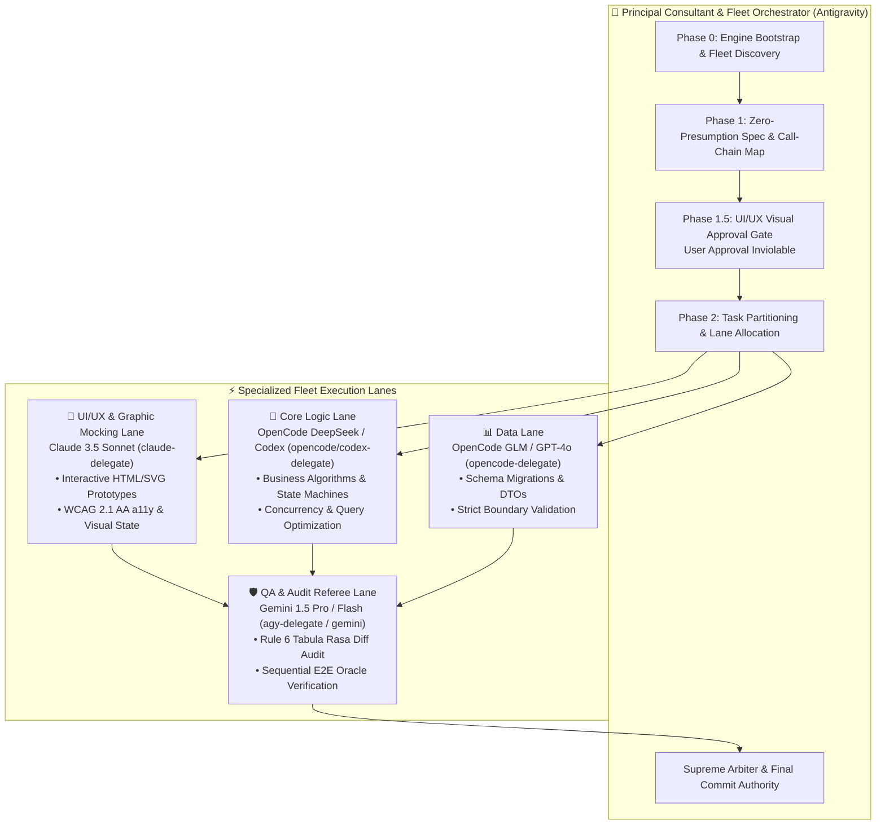
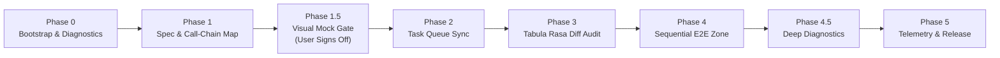
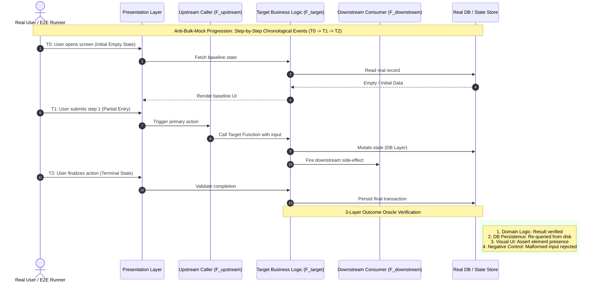
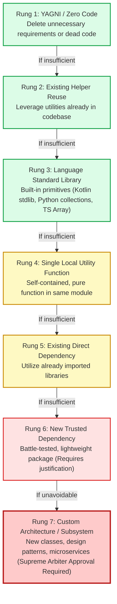
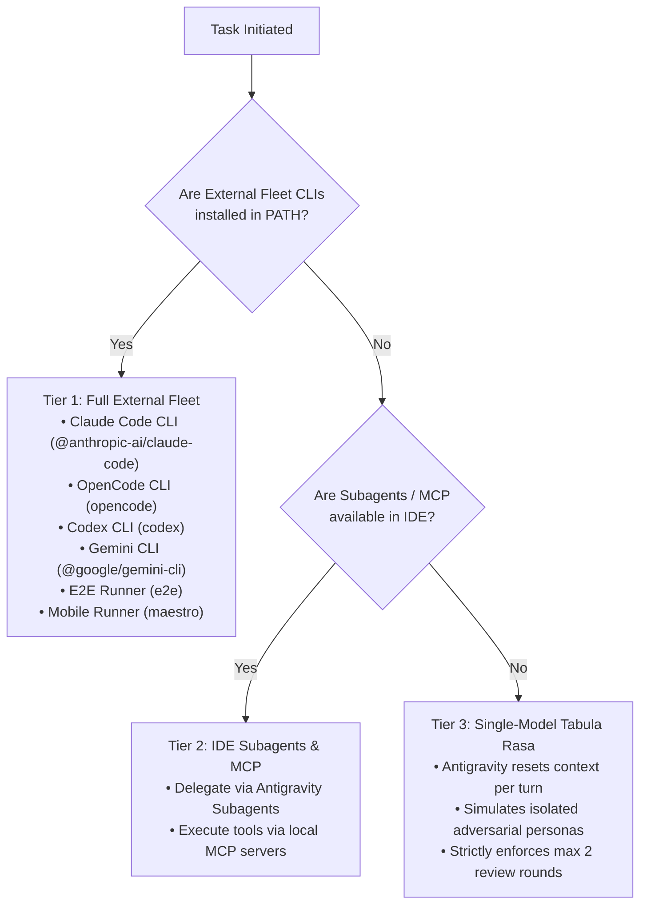

# 🦅 Multi-Agent Collaborative Audit (MACA)

> **Spec-Driven, Ponytail-Optimized, Fleet-Delegated & Sequential E2E Intent-Verified Multi-Agent Engineering Skill.**

[](LICENSE)
[](https://deepmind.google)
[](#-the-5-phase-sdd-workflow)
[](#-the-7-rung-ponytail-minimalism-engine)
[](#-phase-4-dedicated-sequential-e2e--call-chain-verification-zone)
[](#-fleet-architecture--lane-routing)

---

## 🎯 Overview & Mission

Modern AI-assisted software engineering suffers from **four fatal failure modes**:

1. **Agent Bloat & Overengineering**: LLMs generate speculative abstractions, inject unneeded dependencies, or compress multi-step logic into brittle one-liners.
2. **Infinite or Fake Review Loops**: Multi-agent setups either loop indefinitely in circular debates or fake independent review using single-turn `[In-Process]` self-approvals.
3. **The Bulk-Mock & Vacuous Test Illusion**: Tests pass with green `exit code 0` because tests feed pre-baked mock payloads directly into state instead of stepping through real time sequences ($T_0 \to T_1 \to T_2$). The app passes tests, but fails when a human clicks it.
4. **Environment Fragility & Delusion**: Agents assume external CLIs exist, crashing or hallucinating commands when running sandboxed.

**Multi-Agent Collaborative Audit (MACA)** resolves these failure modes deterministically. Led by **Google Antigravity** as the Principal Consultant, MACA enforces a **5-Phase Spec-Driven Workflow**, passes all code through a **7-Rung Ponytail Minimalism Ladder**, bounds adversarial reviews to **2 rounds maximum**, and gates all releases through a **Dedicated Sequential E2E & 3-Layer Outcome Oracle Zone**.

---

## 🏛️ Fleet Architecture & Lane Routing

MACA decouples software delivery into specialized, isolated **Fleet Lanes**. Each lane operates with strict boundaries and zero presumption of correctness from prior steps.



### Fleet Specialization Matrix

| Lane | Default Engine / Model | Primary Deliverables | Strict Boundary |
| :--- | :--- | :--- | :--- |
| **Lead Orchestrator** | **Google Antigravity** | Master plan, preflight, referee rulings, git commits | Supreme Arbiter; breaks ties after Round 2 |
| **🎨 UI/UX Mocking** | **Claude 3.5 Sonnet** | `.agents/mocks/*.html`, vector SVGs, a11y audit | **Visual Gate**: Zero logic coding until user approves mock |
| **🧠 Core Logic** | **OpenCode (DeepSeek/Codex)** | Domain models, algorithms, state engines | Adheres to Ponytail Rungs 1–3 before introducing abstractions |
| **📊 Data** | **OpenCode (GLM/GPT-4o)** | Migrations, DTOs, boundary parsers, schemas | Type-safe null safety; strict external input sanitization |
| **🛡️ QA & Referee** | **Gemini (Pro / Flash)** | Diff audits, call-chain tracing, E2E oracle runs | **Rule 6 Tabula Rasa**: Independent critique; no assumptions |

---

## 🔄 The 5-Phase SDD Engineering Workflow

Every non-trivial engineering task strictly advances through five sequential gates:



### Detailed Gate Breakdown

```
Phase 0: Engine Bootstrap & First-Run Deep Diagnostic
  ├── Run scripts/first_run_preflight.py & scripts/bootstrap.sh
  ├── Verify all 11 external tools (Claude, OpenCode, Codex, Gemini, Playwright, E2E, Maestro)
  └── Fail-Closed Error Reporting: Never proceed silently with broken tooling

Phase 1: Zero-Presumption Spec & Call-Chain Architecture
  ├── Author .agents/SPEC_AND_AUDIT.md
  ├── Map upstream and downstream call chains: (F_upstream -> F_target -> F_downstream)
  └── Pin failure modes, boundaries, and acceptance criteria

Phase 1.5: Inviolable UI/UX Visual Approval Gate (Mandatory for User-Facing UI)
  ├── UI/UX Lane produces self-contained interactive prototype (.agents/mocks/<feature>.html)
  ├── Embed high-fidelity SVGs, real color tokens, and responsive mobile/desktop containers
  └── 🛑 HARD STOP: Present prototype to User. Zero logic coding allowed until User approves!

Phase 2: Task Partitioning & Queue Synchronization
  ├── Synchronize tasks/current_task.md or .agents/PLAN_TASKS.md
  └── Partition work into independent, non-overlapping atomic subtasks

Phase 3: Tabula Rasa Adversarial Diff Audit (Rule 6)
  ├── QA Lane inspects `git diff` with clean slate (Zero prior knowledge or model bias)
  ├── Document findings in .agents/AI_HANDOFF_LEDGER.md (Banning fake `[In-Process]` badges)
  └── Maximum 2 debate rounds; Antigravity Arbiter rules deterministically on unresolved disputes

Phase 4: Dedicated Sequential E2E & 3-Layer Outcome Oracle Zone
  ├── Execute scripts/scenario_and_callchain_engine.py
  ├── Enforce Anti-Bulk-Mock Progression (T0 -> T1 -> T2 chronological events)
  └── Verify 3-Layer Oracle: Domain Logic + DB Persistence + UI Assertion + Negative Control

Phase 4.5: Deep Diagnostics & Performance Profiling
  ├── Inspect Logcat, memory heap, crashlytics, and system traces
  └── Require explicit User Consent before running heavy instrumentation

Phase 5: Telemetry, Desktop Notification & Final Commit
  ├── Calculate project health and Ponytail index (scripts/measure_metrics.py)
  ├── Send native macOS notification (--notify)
  └── Produce atomic git commit with full Fleet Dispatch attribution badge
```

---

## 🧪 Phase 4: Dedicated Sequential E2E & Call-Chain Verification Zone

To bridge the gap between "green tests" and broken software, MACA bans vacuous tests and bulk mocks through [`references/e2e_and_call_chain_testing.md`](references/e2e_and_call_chain_testing.md) and [`scripts/scenario_and_callchain_engine.py`](scripts/scenario_and_callchain_engine.py).



### The 4 Verification Pillars

1. **User-Selected Scenario Modes**:
   * **Mode A (Predefined)**: Hardcoded deterministic test matrices and compliance fixtures.
   * **Mode B (Imaginary Stress Scenarios)**: Generates high-friction edge cases (e.g., dead battery mid-transaction, double taps, rapid orientation flips).
   * **Mode C (Custom Multi-Step)**: User or agent inputs specific step-by-step real user actions.
2. **The Anti-Bulk-Mock Rule**: Banned from loading pre-baked complete final states. Tests must fast-forward through intake and sequentially apply chronological state transitions ($T_0 \to T_1 \to T_2$).
3. **Multi-Caller Call-Chain Tracing**: Validates upstream callers ($F_{upstream}$) and downstream listeners ($F_{downstream}$) under test, strictly banning internal function mocks.
4. **3-Layer Outcome Oracle**:
   $$\text{Oracle} = \text{Domain Logic Result} \land \text{Storage/DB Persistence} \land \text{Visual UI Confirmation} \land \text{Negative Control}$$

---

## ✂️ The 7-Rung Ponytail Minimalism Engine

AI models tend to generate unnecessary abstractions. MACA forces every architectural decision through the **7-Rung Ponytail Decision Ladder** ([`references/ponytail_ladder.md`](references/ponytail_ladder.md)). Agents must exhaust lower rungs before reaching for higher rungs.



* **Target Goal**: $\ge 75\%$ of all logic resolved in **Rungs 1–3**.
* **Debt Tagging**: Any code requiring Rung 6 or 7 must be annotated with:
  ```text
  // ponytail: [Rung 6] Justification for new external dependency
  ```

---

## 🏛️ Skill Ambassador & Procedural Compliance Referee

MACA includes a deterministic compliance referee engine ([`scripts/skill_ambassador_auditor.py`](scripts/skill_ambassador_auditor.py)) that acts as an independent procedural auditor.

### Enforced Compliance Gates

| Gate ID | Mandatory Rule | Required Evidence | Automatic Verdict |
| :---: | :--- | :--- | :---: |
| **G-01** | Phase 0 Bootstrap & Scripts | `./scripts/bootstrap.sh` exit code `0` | `PASS` / `FAIL` |
| **G-02** | Phase 1 Spec & Call-Chain Map | `.agents/SPEC_AND_AUDIT.md` mapped callers | `PASS` / `BLOCKED` |
| **G-03** | Phase 1.5 Visual Mock Gate | `.agents/mocks/*.html` user sign-off | `PASS` / `BLOCKED` |
| **G-04** | Phase 3 Tabula Rasa Diff Audit | Peer critique in `AI_HANDOFF_LEDGER.md` (No fake `[In-Process]`) | `PASS` / `BLOCKED` |
| **G-05** | Phase 4.1 Scenario Mode Choice | Mode A, B, or C explicitly documented | `PASS` / `BLOCKED` |
| **G-06** | Phase 4.2 Anti-Bulk-Mock Rule | Chronological event transitions ($T_0 \to T_1 \to T_2$) | `PASS` / `BLOCKED` |
| **G-07** | Phase 4.3 Call-Chain & Zero Mock | Zero internal function mocks detected | `PASS` / `BLOCKED` |
| **G-08** | Phase 4.4 3-Layer Outcome Oracle | Logic + Storage + UI + Negative Control | `PASS` / `BLOCKED` |
| **G-09** | Task Queue Synchronization | `tasks/current_task.md` marked `- [x]` with date & proof | `PASS` / `BLOCKED` |

---

## 📊 Telemetry, Cockpit Dashboard & Native Notifications

Track project metrics in real time with [`scripts/measure_metrics.py`](scripts/measure_metrics.py).

```bash
# Launch interactive web dashboard (port 8420)
./scripts/measure_metrics.py

# Send native macOS desktop notification upon gate or task completion
./scripts/measure_metrics.py --notify "MACA E2E Complete" "Sequential Oracle & Call-Chain passed!"

# Output structured JSON metrics for CI/CD pipelines
./scripts/measure_metrics.py --json

# Run built-in self-test verification suite
./scripts/measure_metrics.py --self-test
```

### Key Metrics Monitored

* **Overall Efficacy Score (0–100 & Letter Grade)**: Synthesized from simplicity, test pass rate, and review cycle speed.
* **Ponytail Simplicity Index**: Percentage of architectural solutions resolved in Rungs 1–3 vs Rungs 6–7.
* **First-Turn Pass Rate**: Percentage of code patches approved in Round 1 without rework.
* **Arbiter Escalation Count**: Number of cross-lane disputes escalated to the Antigravity Supreme Arbiter.
* **Git Evidence & Provenance Trail**: Live table displaying commit SHAs, author lanes, verified scopes, and Ponytail debt tags.

---

## 🎛️ Tooling Inventory & Multi-Tier Scarcity Cascade

MACA dynamically adapts to your local machine using a **3-Tier Scarcity Cascade**:



### Complete Tooling Matrix

| Tool | Category | Installation Command | Purpose |
| :--- | :--- | :--- | :--- |
| **`claude`** | AI Fleet CLI | `npm install -g @anthropic-ai/claude-code` | Claude 3.5 Sonnet UI/UX Mocking Lane |
| **`opencode`** | AI Fleet CLI | `brew install opencode` | Core Logic (DeepSeek) & Data (GLM) Lane |
| **`codex`** | AI Fleet CLI | `brew install codex` | Algorithmic logic & optimization |
| **`gemini`** | AI Fleet CLI | `npm install -g @google/gemini-cli` | Full-repo review & QA fallback lane |
| **`agy`** | AI Fleet CLI | `brew install agy` | Native Antigravity CLI delegation |
| **`e2e`** | E2E Engine | `npm install -g e2e` | Hybrid AI + Deterministic E2E testing |
| **`maestro`** | Mobile E2E | `curl -Ls 'https://get.maestro.mobile.dev' \| bash` | Mobile UI declarative flow automation |
| **`playwright`**| Web E2E | `npm install -g playwright` | Headless browser execution & DOM capture |
| **`adb`** | Mobile Device| Android Platform-Tools | Android emulator & physical device bridge |

---

## 🚀 Quickstart

### 1. Verify Environment & Preflight
Run the one-time deep diagnostic and preflight check:
```bash
# Run first-run preflight
python3 scripts/first_run_preflight.py

# Verify bootstrap readiness
./scripts/bootstrap.sh
```

### 2. Initialize a Task in Your Workspace
To audit an existing project or initialize a new feature with the Skill Ambassador:
```bash
python3 scripts/skill_ambassador_auditor.py --init-log /path/to/project --feature "FeatureName"
```

### 3. Verify Code with the E2E Scenario Engine
```bash
# Run scenario & call-chain verification suite
python3 scripts/scenario_and_callchain_engine.py --self-test
```

---

## 📜 License & Provenance

Licensed under the [MIT License](LICENSE).

Authored and maintained under the **Multi-Agent Collaborative Audit (MACA)** framework with **Google Antigravity** as Principal Consultant and Lead Orchestrator.
