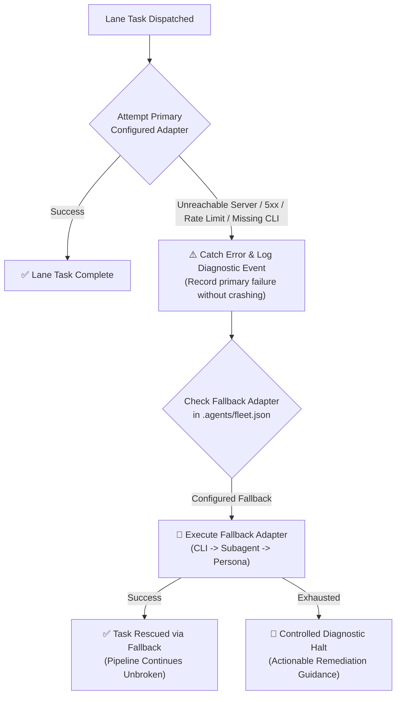
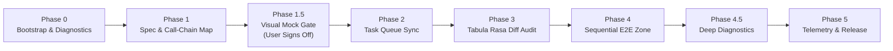
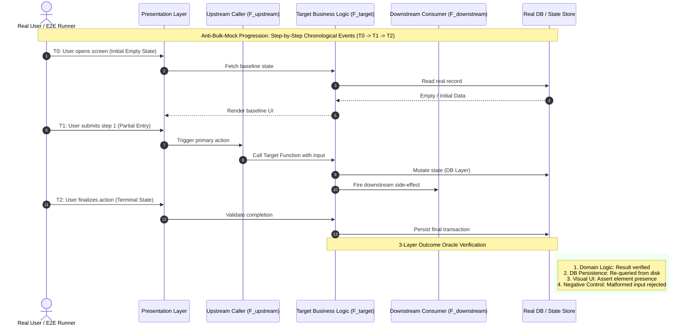
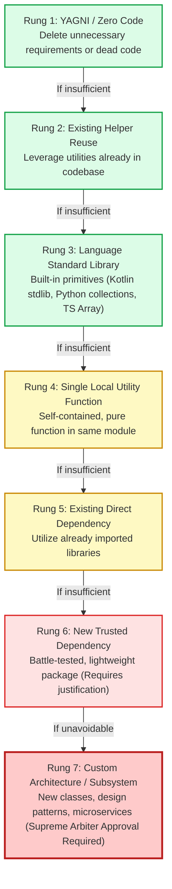

# 🦅 Multi-Agent Collaborative Audit (MACA)

> **Spec-Driven, Ponytail-Optimized, Dynamic Fleet-Routed & Sequential E2E Intent-Verified Multi-Agent Engineering Skill.**

[](LICENSE)
[](https://deepmind.google)
[](#-the-5-phase-sdd-workflow)
[](#-the-7-rung-ponytail-minimalism-engine)
[](#-phase-4-dedicated-sequential-e2e--call-chain-verification-zone)
[](#-dynamic-multi-adapter-fleet-router--zero-api-resilience)

---

## 📑 Table of Contents

* [🎯 Overview & Mission](#-overview--mission)
  * [The 4 Fatal AI Engineering Failure Modes](#the-4-fatal-ai-engineering-failure-modes)
* [🏛️ Model-Agnostic Fleet Architecture](#-model-agnostic-fleet-architecture)
  * [Lane Competency Contracts](#lane-competency-contracts)
* [🔌 Dynamic Multi-Adapter Fleet Router & Zero-API Resilience](#-dynamic-multi-adapter-fleet-router--zero-api-resilience)
  * [The 4 Execution Adapters](#1-the-4-universal-execution-adapters)
  * [Declarative Fleet Manifest (`.agents/fleet.json`)](#2-declarative-fleet-manifest-agentsfleetjson)
  * [Fail-Safe Cascade & Unreachable Server Resilience](#3-unreachable-server--fail-safe-cascade)
  * [Detection, Self-Repair & Resilience Testing](#4-built-in-detection-self-repair--resilience-testing)
* [🔄 The 5-Phase SDD Engineering Workflow](#-the-5-phase-sdd-workflow)
  * [Detailed Gate Breakdown](#detailed-gate-breakdown)
* [🧪 Phase 4: Dedicated Sequential E2E & Call-Chain Verification Zone](#-phase-4-dedicated-sequential-e2e--call-chain-verification-zone)
  * [The 4 Verification Pillars](#the-4-verification-pillars)
* [✂️ The 7-Rung Ponytail Minimalism Engine](#-the-7-rung-ponytail-minimalism-engine)
* [🏛️ Skill Ambassador & Procedural Compliance Referee](#-skill-ambassador--procedural-compliance-referee)
* [📊 Telemetry, Cockpit Dashboard & Native Notifications](#-telemetry-cockpit-dashboard--native-notifications)
* [🚀 Quickstart & Developer Tracks](#-quickstart--developer-tracks)
  * [Track 1: Solo Developer ($0 Zero-API Mode)](#track-1-solo-developer-0-zero-api-mode)
  * [Track 2: Power User (Local AI CLIs)](#track-2-power-user-local-ai-clis)
  * [Track 3: Custom APIs & Local Models (Ollama / DeepSeek)](#track-3-custom-apis--local-models-ollama--deepseek)
* [🛠️ Engine Script Cheatsheet](#-engine-script-cheatsheet)
* [📜 License & Provenance](#-license--provenance)

---

## 🎯 Overview & Mission

### The 4 Fatal AI Engineering Failure Modes

Modern AI-assisted software engineering suffers from **four fatal failure modes**:

1. **Agent Bloat & Overengineering**: LLMs generate speculative abstractions, inject unneeded dependencies, or compress multi-step logic into brittle one-liners.
2. **Infinite or Fake Review Loops**: Multi-agent setups either loop indefinitely in circular debates or fake independent review using single-turn `[In-Process]` self-approvals.
3. **The Bulk-Mock & Vacuous Test Illusion**: Tests pass with green `exit code 0` because tests feed pre-baked mock payloads directly into state instead of stepping through real time sequences ($T_0 \to T_1 \to T_2$). The app passes tests, but fails when a human clicks it.
4. **Environment Fragility & Delusion**: Agents assume external CLIs or specific API keys exist, crashing or halting when running sandboxed or offline.

**Multi-Agent Collaborative Audit (MACA)** resolves these failure modes deterministically. Led by **Google Antigravity** as the Principal Consultant, MACA enforces a **5-Phase Spec-Driven Workflow**, passes all code through a **7-Rung Ponytail Minimalism Ladder**, bounds adversarial reviews to **2 rounds maximum**, and routes execution through a **Dynamic, Model-Agnostic Multi-Adapter Fleet Router** with automated fail-safe cascade.

---

## 🏛️ Model-Agnostic Fleet Architecture

MACA decouples software delivery into specialized, isolated **Fleet Lanes**. Rather than hardcoding rigid models, each lane is defined by a **Functional Competency Contract** that can be powered by your choice of local CLIs, direct APIs, local LLMs (Ollama), or native zero-cost In-IDE subagents.


### Lane Competency Contracts

| Lane | Competency Contract & Deliverables | Supported Providers (Fully Dynamic) | Strict Boundary |
| :--- | :--- | :--- | :--- |
| **Lead Orchestrator** | Master task charter, preflight verification, arbiter rulings, commit authority | Google Antigravity | Supreme Arbiter; breaks ties after Round 2 |
| **🎨 UI/UX Mocking** | Interactive HTML/SVG prototypes (`.agents/mocks/*.html`), vector rendering, responsive layout, a11y audit | Claude Code CLI, Vision APIs, or In-IDE Subagent | **Visual Gate**: Zero logic coding until user approves mock |
| **🧠 Core Logic** | Domain models, algorithms, state engines, mathematical invariants | OpenCode, Codex CLI, Reasoning APIs, or In-IDE Subagent | Adheres to Ponytail Rungs 1–3 before introducing abstractions |
| **📊 Data** | Migrations, DTOs, boundary parsers, schemas, database persistence | OpenCode, Codex CLI, Schema APIs, or In-IDE Subagent | Type-safe null safety; strict external input sanitization |
| **🛡️ QA & Referee** | Adversarial diff reviews, call-chain tracing, sequential E2E oracle runs | Gemini CLI, Deep-Context APIs, or In-IDE Subagent | **Rule 6 Tabula Rasa**: Independent critique; no assumptions |

---

## 🔌 Dynamic Multi-Adapter Fleet Router & Zero-API Resilience

MACA's Fleet Dispatcher ([`scripts/fleet_dispatch.py`](scripts/fleet_dispatch.py)) lets each user configure their own fleet in [`.agents/fleet.json`](resources/templates/fleet.template.json) without depending on specific vendors, paid subscriptions, or proprietary APIs.



### 1. The 4 Universal Execution Adapters

1. **`zero-api` In-IDE Subagents ($0 Cost, Zero Keys)**:
   * **For users who do not have external API keys or paid CLI subscriptions**:
   * Uses native In-IDE subagents or Single-Model Tabula Rasa context-reset personas.
   * Completely self-contained, operates within your active IDE session, and costs nothing.
2. **`cli` Local Agentic CLIs**:
   * Spawns pre-installed AI CLIs (`claude`, `opencode`, `codex`, `agy`, `cursor`, `aider`, `goose`).
   * Inherits your existing terminal authentication, local credentials, and default model setups.
3. **`api` Direct HTTP Endpoints (OpenAI-Compatible & Custom)**:
   * Native HTTP client using Python's standard library (`urllib.request`) — zero npm/pip dependencies.
   * Works with OpenAI, DeepSeek API, Anthropic API, Google GenAI API, OpenRouter, or **free local LLMs** running via **Ollama** (`http://127.0.0.1:11434`) or **vLLM**.
4. **`script` Custom Executable Wrappers**:
   * Executes arbitrary custom agent scripts or binaries (`./scripts/my_agent.sh`).

### 2. Declarative Fleet Manifest (`.agents/fleet.json`)

To customize your fleet, create `.agents/fleet.json` (or generate one automatically with `python3 scripts/fleet_dispatch.py --init-config`):

```json
{
  "lanes": {
    "ui_ux": {
      "primary": { "adapter": "cli", "binary": "claude", "model": "claude-3-7-sonnet" },
      "fallback": { "adapter": "subagent", "role_name": "UI/UX Designer" }
    },
    "core_logic": {
      "primary": {
        "adapter": "api",
        "protocol": "openai-compatible",
        "endpoint": "https://api.deepseek.com/v1/chat/completions",
        "api_key_env": "DEEPSEEK_API_KEY",
        "model": "deepseek-reasoner"
      },
      "fallback": { "adapter": "subagent", "role_name": "Core Logic Engineer" }
    },
    "data": {
      "primary": { "adapter": "cli", "binary": "codex" },
      "fallback": { "adapter": "subagent", "role_name": "Data Architect" }
    },
    "qa_referee": {
      "primary": { "adapter": "cli", "binary": "gemini", "args": ["-p", "{brief}"] },
      "fallback": { "adapter": "subagent", "role_name": "QA Referee" }
    }
  }
}
```

### 3. Unreachable Server & Fail-Safe Cascade

* **Automatic Timeout & Network Protection**: Direct API requests have strict configurable timeouts (default 30s).
* **Fault-Tolerant Cascade**: If a remote API server goes down, returns `HTTP 500/503`, hits rate limits (`HTTP 429`), or an external CLI is uninstalled:
  1. The error is captured gracefully without crashing the turn.
  2. The failure cause is documented in the audit log.
  3. The dispatcher immediately cascades to the designated fallback (such as the In-IDE subagent).
* **Pipeline Continuity**: Work never halts due to transient network failures or missing API credits.

### 4. Built-in Detection, Self-Repair & Resilience Testing

The fleet engine includes a comprehensive test and repair suite:

```bash
# Run comprehensive resilience and fallback self-tests
python3 scripts/fleet_dispatch.py --self-test

# Detect available local CLIs and environment API keys
python3 scripts/fleet_dispatch.py --detect-only

# Initialize a tailored .agents/fleet.json for current workspace
python3 scripts/fleet_dispatch.py --init-config

# Validate and automatically repair missing keys or schema errors
python3 scripts/fleet_dispatch.py --validate .agents/fleet.json
```

---

## 🔄 The 5-Phase SDD Engineering Workflow

Every non-trivial engineering task strictly advances through five sequential gates:



### Detailed Gate Breakdown

```
Phase 0: Engine Bootstrap & First-Run Deep Diagnostic
  ├── Run scripts/first_run_preflight.py & scripts/bootstrap.sh
  ├── Verify all 11 external tools and execution engines
  └── Fail-Closed Error Reporting: Never proceed silently with broken tooling

Phase 1: Zero-Presumption Spec & Call-Chain Architecture
  ├── Author .agents/SPEC_AND_AUDIT.md
  ├── Map upstream and downstream call chains: (F_upstream -> F_target -> F_downstream)
  └── Pin failure modes, boundaries, and acceptance criteria

Phase 1.5: Inviolable UI/UX Visual Approval Gate (Mandatory for User-Facing UI)
  ├── UI/UX Lane produces self-contained interactive prototype (.agents/mocks/<feature>.html)
  ├── Embed high-fidelity SVGs, real color tokens, and responsive mobile/desktop containers
  └── 🛑 HARD STOP: Present prototype to User. Zero logic coding allowed until User approves!

Phase 2: Task Partitioning & Queue Synchronization
  ├── Synchronize tasks/current_task.md or .agents/PLAN_TASKS.md
  └── Partition work into independent, non-overlapping atomic subtasks

Phase 3: Tabula Rasa Adversarial Diff Audit (Rule 6)
  ├── QA Lane inspects `git diff` with clean slate (Zero prior knowledge or model bias)
  ├── Document findings in .agents/AI_HANDOFF_LEDGER.md (Banning fake `[In-Process]` badges)
  └── Maximum 2 debate rounds; Antigravity Arbiter rules deterministically on unresolved disputes

Phase 4: Dedicated Sequential E2E & 3-Layer Outcome Oracle Zone
  ├── Execute scripts/scenario_and_callchain_engine.py
  ├── Enforce Anti-Bulk-Mock Progression (T0 -> T1 -> T2 chronological events)
  └── Verify 3-Layer Oracle: Domain Logic + DB Persistence + UI Assertion + Negative Control

Phase 4.5: Deep Diagnostics & Performance Profiling
  ├── Inspect Logcat, memory heap, crashlytics, and system traces
  └── Require explicit User Consent before running heavy instrumentation

Phase 5: Telemetry, Desktop Notification & Final Commit
  ├── Calculate project health and Ponytail index (scripts/measure_metrics.py)
  ├── Send native macOS notification (--notify)
  └── Produce atomic git commit with full Fleet Dispatch attribution badge
```

---

## 🧪 Phase 4: Dedicated Sequential E2E & Call-Chain Verification Zone

To bridge the gap between "green tests" and broken software, MACA bans vacuous tests and bulk mocks through [`references/e2e_and_call_chain_testing.md`](references/e2e_and_call_chain_testing.md) and [`scripts/scenario_and_callchain_engine.py`](scripts/scenario_and_callchain_engine.py).



### The 4 Verification Pillars

1. **User-Selected Scenario Modes**:
   * **Mode A (Predefined)**: Hardcoded deterministic test matrices and compliance fixtures.
   * **Mode B (Imaginary Stress Scenarios)**: Generates high-friction edge cases (e.g., dead battery mid-transaction, double taps, rapid orientation flips).
   * **Mode C (Custom Multi-Step)**: User or agent inputs specific step-by-step real user actions.
2. **The Anti-Bulk-Mock Rule**: Banned from loading pre-baked complete final states. Tests must fast-forward through intake and sequentially apply chronological state transitions ($T_0 \to T_1 \to T_2$).
3. **Multi-Caller Call-Chain Tracing**: Validates upstream callers ($F_{upstream}$) and downstream listeners ($F_{downstream}$) under test, strictly banning internal function mocks.
4. **3-Layer Outcome Oracle**:
   $$\text{Oracle} = \text{Domain Logic Result} \land \text{Storage/DB Persistence} \land \text{Visual UI Confirmation} \land \text{Negative Control}$$

---

## ✂️ The 7-Rung Ponytail Minimalism Engine

AI models tend to generate unnecessary abstractions. MACA forces every architectural decision through the **7-Rung Ponytail Decision Ladder** ([`references/ponytail_ladder.md`](references/ponytail_ladder.md)). Agents must exhaust lower rungs before reaching for higher rungs.



* **Target Goal**: $\ge 75\%$ of all logic resolved in **Rungs 1–3**.
* **Debt Tagging**: Any code requiring Rung 6 or 7 must be annotated with:
  ```text
  // ponytail: [Rung 6] Justification for new external dependency
  ```

---

## 🏛️ Skill Ambassador & Procedural Compliance Referee

MACA includes a deterministic compliance referee engine ([`scripts/skill_ambassador_auditor.py`](scripts/skill_ambassador_auditor.py)) that acts as an independent procedural auditor.

### Enforced Compliance Gates

| Gate ID | Mandatory Rule | Required Evidence | Automatic Verdict |
| :---: | :--- | :--- | :---: |
| **G-01** | Phase 0 Bootstrap & Scripts | `./scripts/bootstrap.sh` exit code `0` | `PASS` / `FAIL` |
| **G-02** | Phase 1 Spec & Call-Chain Map | `.agents/SPEC_AND_AUDIT.md` mapped callers | `PASS` / `BLOCKED` |
| **G-03** | Phase 1.5 Visual Mock Gate | `.agents/mocks/*.html` user sign-off | `PASS` / `BLOCKED` |
| **G-04** | Phase 3 Tabula Rasa Diff Audit | Peer critique in `AI_HANDOFF_LEDGER.md` (No fake `[In-Process]`) | `PASS` / `BLOCKED` |
| **G-05** | Phase 4.1 Scenario Mode Choice | Mode A, B, or C explicitly documented | `PASS` / `BLOCKED` |
| **G-06** | Phase 4.2 Anti-Bulk-Mock Rule | Chronological event transitions ($T_0 \to T_1 \to T_2$) | `PASS` / `BLOCKED` |
| **G-07** | Phase 4.3 Call-Chain & Zero Mock | Zero internal function mocks detected | `PASS` / `BLOCKED` |
| **G-08** | Phase 4.4 3-Layer Outcome Oracle | Logic + Storage + UI + Negative Control | `PASS` / `BLOCKED` |
| **G-09** | Task Queue Synchronization | `tasks/current_task.md` marked `- [x]` with date & proof | `PASS` / `BLOCKED` |

---

## 📊 Telemetry, Cockpit Dashboard & Native Notifications

Track project metrics in real time with [`scripts/measure_metrics.py`](scripts/measure_metrics.py).

```bash
# Launch interactive web dashboard (port 8420)
./scripts/measure_metrics.py

# Send native macOS desktop notification upon gate or task completion
./scripts/measure_metrics.py --notify "MACA E2E Complete" "Sequential Oracle & Call-Chain passed!"

# Output structured JSON metrics for CI/CD pipelines
./scripts/measure_metrics.py --json

# Run built-in self-test verification suite
./scripts/measure_metrics.py --self-test
```

---

## 🚀 Quickstart & Developer Tracks

Choose the track that fits your development environment:

### Track 1: Solo Developer ($0 Zero-API Mode)
* **Pre-requisites**: None! No external API keys, zero paid subscriptions.
* **How it works**: Antigravity automatically uses native In-IDE subagents and context-isolated personas.
```bash
# 1. Run bootstrap check
./scripts/bootstrap.sh

# 2. Initialize project governance charter
python3 scripts/skill_ambassador_auditor.py --init-log . --feature "MyFeature"
```

### Track 2: Power User (Local AI CLIs)
* **Pre-requisites**: Installed CLIs (`claude`, `opencode`, `codex`, `gemini`, `agy`).
* **How it works**: The router automatically dispatches tasks across your installed tools with fallback protection.
```bash
# 1. Detect installed CLIs
python3 scripts/fleet_dispatch.py --detect-only

# 2. Initialize tailored fleet config
python3 scripts/fleet_dispatch.py --init-config

# 3. Dispatch a task to any lane
python3 scripts/fleet_dispatch.py --dispatch ui_ux --brief "Build responsive SVG header"
```

### Track 3: Custom APIs & Local Models (Ollama / DeepSeek)
* **Pre-requisites**: Local Ollama server or standard API keys in environment.
* **How it works**: Declare your custom endpoints in `.agents/fleet.json`:
```bash
# Point core_logic to local Ollama (100% private, free):
# In .agents/fleet.json -> endpoint: "http://127.0.0.1:11434/v1/chat/completions"

# Validate manifest syntax & reachability
python3 scripts/fleet_dispatch.py --validate .agents/fleet.json
```

---

## 🛠️ Engine Script Cheatsheet

| Script | Primary Command | Key Flags | Role |
| :--- | :--- | :--- | :--- |
| **`bootstrap.sh`** | `./scripts/bootstrap.sh` | `--force-first-run` | Verifies skill integrity & discovers runtime environment |
| **`first_run_preflight.py`** | `python3 scripts/first_run_preflight.py` | `--force`, `--json` | Runs deep 29-item self-test & tool inventory diagnostic |
| **`fleet_dispatch.py`** | `python3 scripts/fleet_dispatch.py` | `--self-test`, `--detect-only`, `--init-config`, `--validate`, `--dispatch <lane>` | Model-agnostic multi-adapter router with fail-safe cascade |
| **`scenario_and_callchain_engine.py`** | `python3 scripts/scenario_and_callchain_engine.py` | `--self-test`, `--mode <A/B/C>`, `--trace-dir <dir>` | Anti-bulk-mock sequential oracle & caller graph tracer |
| **`skill_ambassador_auditor.py`** | `python3 scripts/skill_ambassador_auditor.py` | `--self-test`, `--init-log <dir>`, `--audit-workspace <dir>` | Enforces procedural gates G-01 through G-09 |
| **`measure_metrics.py`** | `python3 scripts/measure_metrics.py` | `--self-test`, `--notify <Title> <Msg>`, `--json`, `--port <n>` | Telemetry cockpit, notifications & Ponytail analytics |

---

## 📜 License & Provenance

Licensed under the [MIT License](LICENSE).

Authored and maintained under the **Multi-Agent Collaborative Audit (MACA)** framework with **Google Antigravity** as Principal Consultant and Lead Orchestrator.
